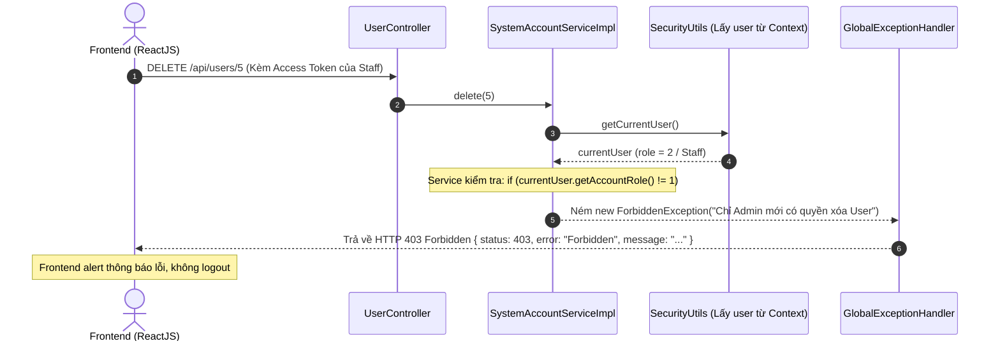
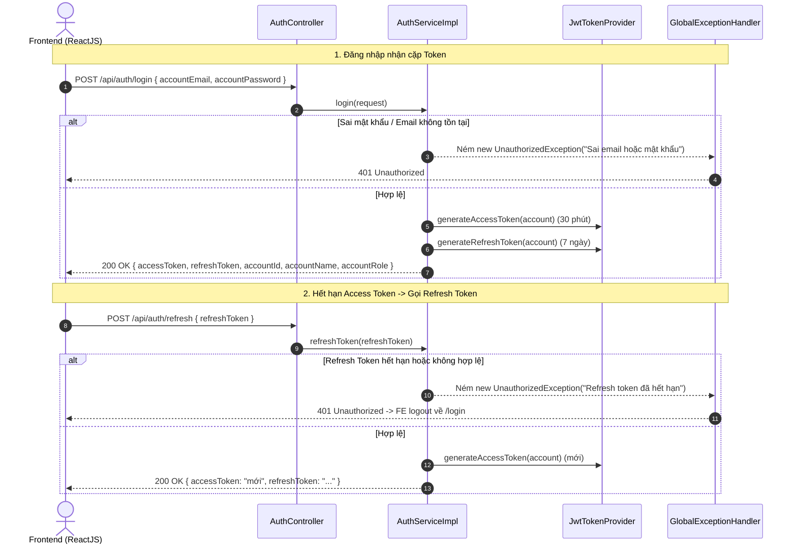

# Kế hoạch Security Tinh Gọn: Cặp Token (Access + Refresh) & Bắt Lỗi 401/403 tại Service (NMS_BE)

Tài liệu này điều chỉnh lại thiết kế hệ thống bảo mật cho dự án **FUNewsManagementSystem (NMS_BE)** theo hướng **thực tế, tinh gọn, dễ hiểu và dễ bảo trì**. Hệ thống giữ nguyên mô hình **Cặp Token (Access Token & Refresh Token)**, nhưng **đơn giản hóa việc phân quyền và bắt lỗi 401/403 trực tiếp tại tầng Service/Controller** thông qua `GlobalExceptionHandler` quen thuộc, không làm phức tạp hóa tầng Filter của Spring Security.

---

## 1. Tư duy Thiết kế Tinh Gọn (Pragmatic Approach)

### 1.1. Giữ nguyên mô hình Cặp Token (Dual-Token)
* **Access Token (Ngắn hạn - 30 phút):** JWT chứa thông tin tài khoản (`email`, `accountId`, `role`). Gửi kèm mỗi request qua header `Authorization: Bearer <accessToken>`.
* **Refresh Token (Dài hạn - 7 ngày):** Token dùng để cấp lại Access Token mới tại API `POST /api/auth/refresh` khi Access Token hết hạn, giúp người dùng không phải nhập lại mật khẩu liên tục.
* **Cơ chế sinh token:** Sử dụng thư viện JWT (`jjwt 0.12.6`) ký số bằng Secret Key. Có thể triển khai thuần stateless (Refresh Token dạng JWT có claim `type: "REFRESH"`) hoặc lưu đơn giản trong bảng DB.

### 1.2. Đơn giản hóa Xử lý 401 / 403 tại Tầng Service & Controller
Thay vì cấu hình phức tạp nhiều lớp `AuthenticationEntryPoint` hay `AccessDeniedHandler` ở Servlet Filter:
* **Tầng Filter (`JwtFilter`):** Chỉ làm nhiệm vụ giải mã token và trích xuất thông tin người dùng (`SystemAccount`) nạp vào `SecurityContext` (hoặc `request.setAttribute("currentUser", account)`).
* **Kiểm tra quyền tại Service / Controller:**
  * Kiểm tra vai trò trực tiếp bằng câu lệnh `if`:
    ```java
    // Nếu không phải Admin (role = 1) -> ném ForbiddenException
    if (currentUser.getAccountRole() != SystemAccount.ADMIN_ROLE) {
        throw new ForbiddenException("Chỉ tài khoản Quản trị viên (Admin) mới có quyền thực hiện thao tác này");
    }
    ```
* **Bắt lỗi tập trung 100% trong `GlobalExceptionHandler`:**
  * Bắt `UnauthorizedException` $\rightarrow$ Trả về mã **HTTP 401 Unauthorized**.
  * Bắt `ForbiddenException` $\rightarrow$ Trả về mã **HTTP 403 Forbidden**.
  * Cả hai đều tự động trả về định dạng JSON chuẩn `ApiErrorResponse` đã có sẵn của dự án.

---

## 2. Bảng Phân Định 401 và 403 tại Service

| Mã HTTP | Tên lỗi | Tình huống xảy ra ở Service | Exception ném ra | Phản ứng phía Frontend (ReactJS) |
| :---: | :--- | :--- | :--- | :--- |
| **401** | **Unauthorized** *(Chưa xác thực)* | 1. Đăng nhập sai email hoặc sai mật khẩu.<br>2. Gửi request mà không có token hoặc token không hợp lệ.<br>3. Gọi API `/api/auth/refresh` với Refresh Token đã hết hạn/sai. | `UnauthorizedException`<br>(hoặc `BadCredentialsException`) | • Nếu đang gọi API thường bị 401 $\rightarrow$ Tự gọi `/api/auth/refresh` để xin cấp lại token.<br>• Nếu refresh token cũng 401 $\rightarrow$ Chuyển về trang `/login`. |
| **403** | **Forbidden** *(Không đủ quyền)* | 1. Người dùng Staff (`role = 2`) gọi API User Management ([`/api/users/**`](file:///c:/Fall%202026/SBA301/SBA301_ASS/NMS_BE/src/main/java/com/mvc/nms_be/controller/UserController.java)).<br>2. Staff cố ý tạo/xóa danh mục hoặc thao tác vượt quyền. | `ForbiddenException`<br>(hoặc `AccessDeniedException`) | • **Tuyệt đối không gọi refresh token**.<br>• Hiển thị thông báo Alert/Toast: *"Bạn không có quyền thực hiện chức năng này!"*. Giữ nguyên trang. |

---

## 3. Sơ đồ Luồng Hoạt động Tinh Gọn

### 3.1. Luồng Kiểm tra Quyền & Xử lý 403 tại Service



---

### 3.2. Luồng Đăng nhập & Refresh Token (HTTP 401)



---

## 4. Các File Cần Thêm Mới & Chỉnh Sửa

```
NMS_BE/
├── pom.xml                                   <-- Thêm spring-boot-starter-security, jjwt
├── src/main/resources/
│   └── application.properties                <-- Cấu hình secret key và thời hạn 2 token
└── src/main/java/com/mvc/nms_be/
    ├── config/
    │   ├── SecurityConfig.java               <-- Tắt CSRF, bật CORS, mở permitAll() cho /api/auth/**
    │   └── DataInitializer.java              <-- Seed tài khoản Admin mặc định (admin@fu.edu.vn / Admin@123)
    ├── controller/
    │   └── AuthController.java               <-- Endpoints: /api/auth/login, /api/auth/refresh, /api/auth/me
    ├── dto/
    │   ├── request/
    │   │   ├── LoginRequestDto.java          <-- Body login (email, password)
    │   │   └── RefreshTokenRequestDto.java   <-- Body refresh (refreshToken)
    │   └── response/
    │       ├── LoginResponseDto.java         <-- Trả về accessToken, refreshToken, userInfo
    │       └── TokenRefreshResponseDto.java  <-- Trả về accessToken mới
    ├── exception/
    │   ├── UnauthorizedException.java        <-- [Mới] Ngoại lệ gây ra lỗi 401
    │   ├── ForbiddenException.java           <-- [Mới] Ngoại lệ gây ra lỗi 403
    │   └── GlobalExceptionHandler.java       <-- [Sửa] Bổ sung @ExceptionHandler cho 401 và 403
    ├── security/
    │   ├── JwtTokenProvider.java             <-- Sinh & xác thực Access Token (30m) và Refresh Token (7d)
    │   ├── JwtFilter.java                    <-- Đọc Bearer token từ header và nạp vào SecurityContext
    │   └── SecurityUtils.java                <-- Helper: getCurrentUser(), requireAdmin()
    └── service/
        ├── AuthService.java                  <-- login, refresh token
        ├── impl/
        │   ├── AuthServiceImpl.java          <-- Xử lý đăng nhập, cấp token, băm mật khẩu
        │   └── SystemAccountServiceImpl.java <-- Băm mật khẩu BCrypt; kiểm tra requireAdmin() khi sửa/xóa
```

---

## 5. Đặc tả Code Cốt Lõi

### 5.1. Hai Exception Tinh Gọn Cho 401 & 403

* **[`UnauthorizedException.java`](file:///c:/Fall%202026/SBA301/SBA301_ASS/NMS_BE/src/main/java/com/mvc/nms_be/exception/UnauthorizedException.java)**:
  ```java
  package com.mvc.nms_be.exception;

  public class UnauthorizedException extends RuntimeException {
      public UnauthorizedException(String message) {
          super(message);
      }
  }
  ```

* **[`ForbiddenException.java`](file:///c:/Fall%202026/SBA301/SBA301_ASS/NMS_BE/src/main/java/com/mvc/nms_be/exception/ForbiddenException.java)**:
  ```java
  package com.mvc.nms_be.exception;

  public class ForbiddenException extends RuntimeException {
      public ForbiddenException(String message) {
          super(message);
      }
  }
  ```

---

### 5.2. Cập nhật `GlobalExceptionHandler.java`
Chỉ cần thêm 2 phương thức bắt exception cực kỳ quen thuộc:

```java
@ExceptionHandler(UnauthorizedException.class)
public ResponseEntity<Object> handleUnauthorized(UnauthorizedException ex, WebRequest request) {
    return error(HttpStatus.UNAUTHORIZED, ex.getMessage(), Map.of(), request);
}

@ExceptionHandler(ForbiddenException.class)
public ResponseEntity<Object> handleForbidden(ForbiddenException ex, WebRequest request) {
    return error(HttpStatus.FORBIDDEN, ex.getMessage(), Map.of(), request);
}
```

---

### 5.3. Kiểm tra Quyền Đơn giản tại Service (`SystemAccountServiceImpl.java`)

```java
@Override
@Transactional
public SystemAccountResponseDto create(SystemAccountRequestDto request) {
    // 1. Kiểm tra quyền: Chỉ Admin mới được tạo tài khoản
    SecurityUtils.requireAdmin();

    // 2. Băm mật khẩu BCrypt
    String encodedPassword = passwordEncoder.encode(request.getAccountPassword());
    SystemAccount account = accountMapper.toEntity(request, encodedPassword);
    return accountMapper.toResponseDto(accountRepository.saveAndFlush(account));
}

@Override
@Transactional
public void delete(Integer id) {
    // Chỉ Admin mới được xóa tài khoản
    SecurityUtils.requireAdmin();

    SystemAccount account = findAccount(id);
    accountRepository.delete(account);
    accountRepository.flush();
}
```

Với `SecurityUtils.requireAdmin()`:
```java
public static void requireAdmin() {
    SystemAccount current = getCurrentUser();
    if (current == null || current.getAccountRole() != SystemAccount.ADMIN_ROLE) {
        throw new ForbiddenException("Bạn không có quyền thực hiện thao tác này. Yêu cầu quyền Quản trị viên (Admin)!");
    }
}
```

---

### 5.4. Cơ chế Cặp Token trong `JwtTokenProvider.java`
Ký cả 2 token dưới dạng JWT có thời hạn và loại token rõ ràng:

```java
@Component
public class JwtTokenProvider {

    @Value("${jwt.secret:404E635266556A586E3272357538782F413F4428472B4B6250645367566B5970}")
    private String jwtSecret;

    private final long ACCESS_TOKEN_VALIDITY = 30 * 60 * 1000L;       // 30 phút
    private final long REFRESH_TOKEN_VALIDITY = 7 * 24 * 60 * 60 * 1000L; // 7 ngày

    // Sinh Access Token
    public String generateAccessToken(SystemAccount account) {
        return Jwts.builder()
                .subject(account.getAccountEmail())
                .claim("accountId", account.getAccountId())
                .claim("accountRole", account.getAccountRole())
                .claim("accountName", account.getAccountName())
                .claim("type", "ACCESS")
                .issuedAt(new Date())
                .expiration(new Date(System.currentTimeMillis() + ACCESS_TOKEN_VALIDITY))
                .signWith(getSigningKey())
                .compact();
    }

    // Sinh Refresh Token
    public String generateRefreshToken(SystemAccount account) {
        return Jwts.builder()
                .subject(account.getAccountEmail())
                .claim("accountId", account.getAccountId())
                .claim("type", "REFRESH")
                .issuedAt(new Date())
                .expiration(new Date(System.currentTimeMillis() + REFRESH_TOKEN_VALIDITY))
                .signWith(getSigningKey())
                .compact();
    }

    // Kiểm tra tính hợp lệ của token
    public boolean validateToken(String token) {
        try {
            Jwts.parser().verifyWith(getSigningKey()).build().parseSignedClaims(token);
            return true;
        } catch (JwtException | IllegalArgumentException e) {
            return false;
        }
    }
}
```

---

### 5.5. Cấu hình Spring Security Tối giản (`SecurityConfig.java`)
Cấu hình không còn các lớp phức tạp, chỉ cần:
1. Mở cửa cho `/api/auth/**` (login, refresh).
2. Tắt CSRF (vì là REST API).
3. Bật CORS cho Frontend.
4. Gắn `JwtFilter` để đọc user vào Context.

```java
@Configuration
@EnableWebSecurity
@RequiredArgsConstructor
public class SecurityConfig {

    private final JwtFilter jwtFilter;

    @Bean
    public PasswordEncoder passwordEncoder() {
        return new BCryptPasswordEncoder();
    }

    @Bean
    public SecurityFilterChain filterChain(HttpSecurity http) throws Exception {
        http
            .csrf(csrf -> csrf.disable())
            .cors(Customizer.withDefaults())
            .sessionManagement(sess -> sess.sessionCreationPolicy(SessionCreationPolicy.STATELESS))
            .authorizeHttpRequests(auth -> auth
                .requestMatchers("/api/auth/**").permitAll()
                .anyRequest().permitAll() // Quyền chi tiết được kiểm tra chặt chẽ tại Service qua requireAdmin()
            )
            .addFilterBefore(jwtFilter, UsernamePasswordAuthenticationFilter.class);

        return http.build();
    }
}
```
*(Ghi chú: Việc để `.anyRequest().permitAll()` ở Filter và kiểm tra quyền tại Service giúp toàn bộ lỗi 403 đều được ném ra từ Service và bay thẳng vào `GlobalExceptionHandler`, không bao giờ bị Spring Security Filter chặn lén lút).*

---

## 6. Hướng dẫn Tích hợp Frontend Đơn Giản

### 6.1. Trang Login (`Login.jsx`)
```javascript
const handleLogin = async (e) => {
  e.preventDefault();
  try {
    const res = await axios.post('http://localhost:8080/api/auth/login', {
      accountEmail: username,
      accountPassword: password
    });
    localStorage.setItem('accessToken', res.data.accessToken);
    localStorage.setItem('refreshToken', res.data.refreshToken);
    localStorage.setItem('user', JSON.stringify({
      accountId: res.data.accountId,
      accountName: res.data.accountName,
      role: res.data.accountRole
    }));
    navigate('/dashboard');
  } catch (err) {
    setError('Email hoặc mật khẩu không chính xác!');
  }
};
```

### 6.2. Axios Interceptor Xử lý 401 & 403 Cực Gọn
```javascript
import axios from 'axios';

const api = axios.create({ baseURL: 'http://localhost:8080/api' });

// 1. Tự đính kèm token
api.interceptors.request.use((config) => {
  const token = localStorage.getItem('accessToken');
  if (token) config.headers.Authorization = `Bearer ${token}`;
  return config;
});

// 2. Xử lý lỗi 401 và 403
api.interceptors.response.use(
  (res) => res,
  async (err) => {
    const originalRequest = err.config;

    // Lỗi 403: Không đủ quyền -> Alert, không logout!
    if (err.response?.status === 403) {
      alert(err.response.data?.message || 'Bạn không có quyền thực hiện chức năng này!');
      return Promise.reject(err);
    }

    // Lỗi 401: Hết hạn token -> Thử refresh 1 lần
    if (err.response?.status === 401 && !originalRequest._retry) {
      originalRequest._retry = true;
      const refreshToken = localStorage.getItem('refreshToken');
      if (refreshToken) {
        try {
          const res = await axios.post('http://localhost:8080/api/auth/refresh', { refreshToken });
          localStorage.setItem('accessToken', res.data.accessToken);
          originalRequest.headers.Authorization = `Bearer ${res.data.accessToken}`;
          return api(originalRequest); // Thử lại request cũ với token mới
        } catch (refreshErr) {
          // Refresh thất bại -> Logout
          localStorage.clear();
          window.location.href = '/login';
        }
      } else {
        localStorage.clear();
        window.location.href = '/login';
      }
    }

    return Promise.reject(err);
  }
);

export default api;
```

---

## 7. Lộ trình Thực Hiện Tinh Gọn (Chỉ 7 Bước)

| Bước | Công việc | Kết quả |
| :---: | :--- | :--- |
| **1** | Bổ sung `spring-boot-starter-security` và `jjwt 0.12.6` vào `pom.xml`. | Build thành công thư viện. |
| **2** | Tạo 2 exception `UnauthorizedException` (401) và `ForbiddenException` (403); thêm `@ExceptionHandler` vào `GlobalExceptionHandler`. | Xử lý lỗi 401 và 403 tập trung tại đúng 1 file. |
| **3** | Viết `JwtTokenProvider` sinh và kiểm tra cặp token Access/Refresh. | Sẵn sàng bộ công cụ sinh token. |
| **4** | Viết `JwtFilter` và `SecurityConfig` (bật BCryptPasswordEncoder, nạp user vào Context). | Hệ thống nhận diện được Bearer Token. |
| **5** | Viết `AuthService` và `AuthController` (`/api/auth/login`, `/api/auth/refresh`, `/api/auth/me`). | API đăng nhập & cấp token hoạt động. |
| **6** | Băm mật khẩu trong `SystemAccountServiceImpl` & thêm kiểm tra `SecurityUtils.requireAdmin()`. | Mật khẩu được mã hóa an toàn, phân quyền Admin/Staff chặt chẽ. |
| **7** | Tạo `DataInitializer` tạo sẵn Admin mặc định (`admin@fu.edu.vn` / `Admin@123`) để test ngay. | Hoàn tất 100% hệ thống Security. |
