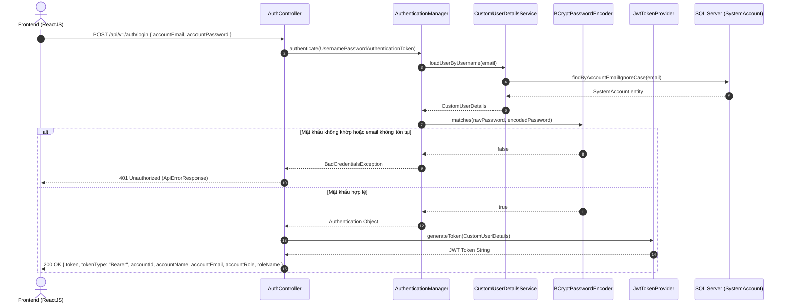
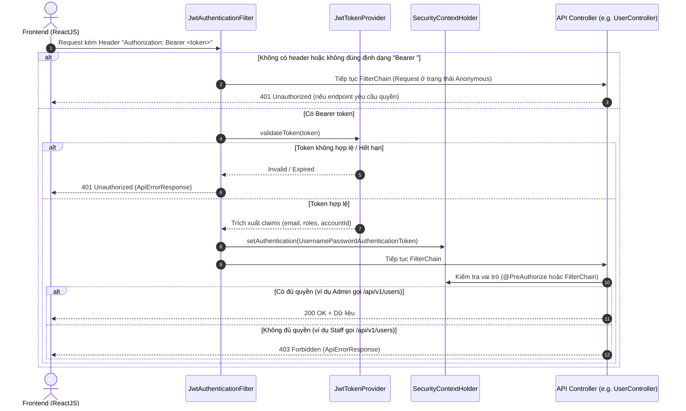

# Kế hoạch Xây dựng Security cho Backend (NMS_BE)

Các API trong kế hoạch hiện dùng tiền tố `/api/v1/`; xem [triển khai và kiểm thử hiện tại](security-implementation.md).

Tài liệu này mô tả chi tiết kế hoạch thiết kế và triển khai hệ thống xác thực (Authentication) & phân quyền (Authorization) cho Backend dự án **FUNewsManagementSystem (NMS_BE)** sử dụng **Spring Security 6+**, **JWT (JSON Web Token)** và băm mật khẩu một chiều bằng **BCrypt**.

---

## 1. Mục tiêu & Hiện trạng Hệ thống

### 1.1. Hiện trạng
* **Nền tảng:** Java 21, Spring Boot, Spring Data JPA, Hibernate, SQL Server.
* **Tài khoản (`SystemAccount`):** 
  * Cột: `AccountID`, `AccountName`, `AccountEmail` (UNIQUE), `AccountRole` (`1=Admin`, `2=Staff`), `AccountPassword` (`VARCHAR(255)`).
  * Hiện tại: Mật khẩu đang được lưu dạng văn bản thô (Plain Text) khi tạo/sửa user qua `UserController` và `SystemAccountServiceImpl`.
* **Bảo mật:**
  * Toàn bộ API hiện chưa có lớp bảo vệ (chưa cài Spring Security).
  * Chưa có endpoint đăng nhập (`/api/v1/auth/login`) và endpoint lấy thông tin tài khoản hiện tại (`/api/v1/auth/me`).
  * Thực thể `NewsArticle` có các khóa ngoại `CreatedByID` và `UpdatedByID`, nhưng chưa có cơ chế tự động trích xuất thông tin người dùng đang đăng nhập từ Security Context.

### 1.2. Mục tiêu kỹ thuật
1. **Hash mật khẩu bằng BCrypt:** Mã hóa toàn bộ mật khẩu trước khi lưu vào database; không lưu plain text ở bất kỳ khâu nào.
2. **Xác thực phi trạng thái (Stateless Authentication) bằng JWT:** 
   * Cung cấp endpoint đăng nhập trả về Access Token.
   * Client gửi token qua HTTP header: `Authorization: Bearer <token>`.
3. **Phân quyền theo vai trò (RBAC - Role-Based Access Control):**
   * `AccountRole = 1` $\rightarrow$ `ROLE_ADMIN`: Toàn quyền quản trị, quản lý tài khoản người dùng (`/api/v1/users/**`), quản lý danh mục, bài viết và xem dashboard.
   * `AccountRole = 2` $\rightarrow$ `ROLE_STAFF`: Quản lý bài viết cá nhân, xem danh mục, xem thông báo, không có quyền truy cập CRUD người dùng.
4. **Cấu hình CORS & Chuẩn hóa lỗi:**
   * Cho phép kết nối an toàn từ Frontend ReactJS (Vite: `http://localhost:5173`).
   * Chuẩn hóa phản hồi lỗi `401 Unauthorized` và `403 Forbidden` đồng nhất với cấu trúc `ApiErrorResponse` hiện có của dự án.
5. **Khởi tạo dữ liệu mặc định (Data Seeding):**
   * Tự động tạo tài khoản Admin mặc định (`admin@fu.edu.vn` / `Admin@123`) có mật khẩu đã được băm khi hệ thống khởi động lần đầu nếu bảng tài khoản chưa có dữ liệu.

---

## 2. Kiến trúc & Sơ đồ Luồng

### 2.1. Luồng Đăng nhập (Login Flow)



### 2.2. Luồng Kiểm tra Request có JWT (Authenticated Request Flow)



---

## 3. Cấu trúc File Cần Thêm & Chỉnh Sửa

```
NMS_BE/
├── pom.xml                                   <-- [Sửa] Thêm spring-boot-starter-security, jjwt
├── src/main/resources/
│   └── application.properties                <-- [Sửa] Thêm cấu hình jwt.secret, jwt.expiration-ms
└── src/main/java/com/mvc/nms_be/
    ├── config/
    │   ├── SecurityConfig.java               <-- [Mới] Cấu hình SecurityFilterChain, CORS, PasswordEncoder Bean
    │   └── DataInitializer.java              <-- [Mới] Seed tài khoản Admin mặc định có mật khẩu đã hash
    ├── controller/
    │   ├── AuthController.java               <-- [Mới] API /api/v1/auth/login, /api/v1/auth/me
    │   └── UserController.java               <-- [Sửa] Thêm @PreAuthorize("hasRole('ADMIN')")
    ├── dto/
    │   ├── request/
    │   │   └── LoginRequestDto.java          <-- [Mới] DTO nhận thông tin đăng nhập
    │   └── response/
    │       └── LoginResponseDto.java         <-- [Mới] DTO trả về token và thông tin user sau khi login
    ├── exception/
    │   └── GlobalExceptionHandler.java       <-- [Sửa] Bổ sung xử lý BadCredentialsException, AccessDeniedException
    ├── repository/
    │   └── SystemAccountRepository.java      <-- [Sửa] Thêm findByAccountEmailIgnoreCase(String email)
    ├── security/
    │   ├── CustomUserDetails.java            <-- [Mới] Triển khai UserDetails bao bọc SystemAccount
    │   ├── CustomUserDetailsService.java     <-- [Mới] Load user từ database theo email
    │   ├── JwtAuthenticationEntryPoint.java  <-- [Mới] Xử lý lỗi 401 Unauthorized trả về ApiErrorResponse
    │   ├── CustomAccessDeniedHandler.java    <-- [Mới] Xử lý lỗi 403 Forbidden trả về ApiErrorResponse
    │   ├── JwtAuthenticationFilter.java      <-- [Mới] Bộ lọc OncePerRequestFilter xác thực Bearer JWT
    │   ├── JwtTokenProvider.java             <-- [Mới] Xử lý tạo, parse, kiểm tra hạn và ký số JWT
    │   └── SecurityUtils.java                <-- [Mới] Tiện ích lấy User hiện tại đang đăng nhập từ Context
    └── service/
        ├── AuthService.java                  <-- [Mới] Interface nghiệp vụ đăng nhập
        ├── impl/
        │   ├── AuthServiceImpl.java          <-- [Mới] Cài đặt authenticate và cấp token
        │   └── SystemAccountServiceImpl.java <-- [Sửa] Hash mật khẩu bằng PasswordEncoder khi tạo/sửa user
```

---

## 4. Đặc tả Kỹ thuật Từng Thành phần

### 4.1. Thư viện Dependency (`pom.xml`)
Cần bổ sung các dependency sau:
* `org.springframework.boot:spring-boot-starter-security`: Cung cấp bộ khung lọc bảo mật, PasswordEncoder, context.
* `io.jsonwebtoken:jjwt-api:0.12.6`, `jjwt-impl`, `jjwt-jackson`: Thư viện xử lý JWT hiện đại, bảo mật và hỗ trợ Java 21+.

### 4.2. Cấu hình Tham số (`application.properties`)
```properties
# JWT Configuration
# Chuỗi secret tối thiểu 256 bits mã hóa hex/base64
jwt.secret=${JWT_SECRET:404E635266556A586E3272357538782F413F4428472B4B6250645367566B5970}
# Thời hạn sống của token: 86400000 ms = 24 giờ
jwt.expiration-ms=${JWT_EXPIRATION_MS:86400000}
```

### 4.3. Băm mật khẩu (BCrypt)
* Bean `PasswordEncoder`:
  ```java
  @Bean
  public PasswordEncoder passwordEncoder() {
      return new BCryptPasswordEncoder();
  }
  ```
* Tích hợp vào `SystemAccountServiceImpl`:
  * Khi tạo tài khoản (`create`): băm mật khẩu `passwordEncoder.encode(request.getAccountPassword())` trước khi đưa vào entity và lưu xuống database.
  * Khi cập nhật tài khoản (`update`): nếu mật khẩu được cung cấp mới, tiến hành băm mật khẩu mới; nếu giữ nguyên, không mã hóa đè chuỗi hash cũ.

### 4.4. Ánh xạ Vai trò (Role Mapping) & UserDetails
* Ánh xạ từ cơ sở dữ liệu:
  * `AccountRole = 1` $\rightarrow$ Authority: `ROLE_ADMIN`
  * `AccountRole = 2` $\rightarrow$ Authority: `ROLE_STAFF`
* Lớp `CustomUserDetails` cài đặt `UserDetails`, chứa tham chiếu đến `SystemAccount`, cung cấp ID, email, tên và vai trò.

### 4.5. Phân quyền Endpoint (Authorization Matrix)

| Endpoint | Method | Quyền yêu cầu | Mô tả |
| :--- | :---: | :---: | :--- |
| `/api/v1/auth/login` | `POST` | `permitAll()` | Đăng nhập hệ thống |
| `/api/v1/auth/me` | `GET` | `authenticated()` | Lấy thông tin tài khoản hiện tại |
| `/api/v1/users/**` | `GET, POST, PUT, DELETE` | `hasRole('ADMIN')` | Quản lý người dùng (chỉ Admin) |
| `/api/v1/categories/**` | `GET` | `hasAnyRole('ADMIN', 'STAFF')` | Xem danh mục |
| `/api/v1/categories/**` | `POST, PUT, DELETE` | `hasRole('ADMIN')` | Thêm, sửa, xóa danh mục (Admin) |
| `/api/v1/news/**` | `GET` | `permitAll()` hoặc `authenticated()` | Xem tin tức |
| `/api/v1/news/**` | `POST, PUT, DELETE` | `hasAnyRole('ADMIN', 'STAFF')` | Quản lý tin tức (Admin / Staff) |
| `/api/v1/dashboard/**` | `GET` | `hasAnyRole('ADMIN', 'STAFF')` | Xem thống kê Dashboard |
| `/api/v1/notifications/**`| `GET, PUT` | `authenticated()` | Xem & cập nhật trạng thái thông báo |

### 4.6. Trợ cấp Kiểm toán Tự động (`SecurityUtils`)
Thực thể `NewsArticle` có các trường `createdBy` và `updatedBy`.
Xây dựng `SecurityUtils.getCurrentUser()` để lấy tài khoản `SystemAccount` đang thực hiện request từ `SecurityContextHolder`:
* Khi tạo bài viết (`NewsArticleService.create`): gán `article.setCreatedBy(currentUser)`.
* Khi cập nhật bài viết (`NewsArticleService.update`): gán `article.setUpdatedBy(currentUser)` và cập nhật `modifiedDate`.

### 4.7. Khởi tạo dữ liệu mẫu (Data Seeding)
Tạo `DataInitializer` implements `CommandLineRunner`:
* Kiểm tra `accountRepository.count() == 0` hoặc kiểm tra xem tài khoản admin đã tồn tại chưa (`existsByAccountEmailIgnoreCase("admin@fu.edu.vn")`).
* Nếu chưa tồn tại, tự động tạo tài khoản:
  * `AccountName`: "System Administrator"
  * `AccountEmail`: "admin@fu.edu.vn"
  * `AccountRole`: 1 (Admin)
  * `AccountPassword`: `passwordEncoder.encode("Admin@123")`
* Giúp hệ thống có sẵn tài khoản quản trị để đăng nhập và test ngay khi khởi động.

---

## 5. Lộ trình Triển khai Chi tiết

| Bước | Nhiệm vụ | Chi tiết thực hiện |
| :---: | :--- | :--- |
| **1** | Bổ sung dependencies | Cập nhật `pom.xml` với `spring-boot-starter-security` và `jjwt 0.12.6`. |
| **2** | Cấu hình properties | Thêm `jwt.secret` và `jwt.expiration-ms` vào `application.properties`. |
| **3** | Repository & Entity | Bổ sung phương thức `findByAccountEmailIgnoreCase` vào `SystemAccountRepository`. |
| **4** | Password Hashing | Định nghĩa Bean `PasswordEncoder` (`BCryptPasswordEncoder`); cập nhật `SystemAccountServiceImpl` để băm mật khẩu khi lưu. |
| **5** | Data Seeder | Tạo `DataInitializer` tự động sinh tài khoản Admin mặc định (`admin@fu.edu.vn` / `Admin@123`) có mật khẩu đã hash. |
| **6** | UserDetails Service | Tạo `CustomUserDetails` và `CustomUserDetailsService` load tài khoản theo email từ database. |
| **7** | JWT Component | Xây dựng `JwtTokenProvider` (sinh token, giải mã claims, kiểm tra hạn) và `JwtAuthenticationFilter` (chặn Bearer token). |
| **8** | Xử lý lỗi bảo mật | Viết `JwtAuthenticationEntryPoint` (401) và `CustomAccessDeniedHandler` (403) trả về format `ApiErrorResponse`. |
| **9** | Cấu hình Security | Viết `SecurityConfig`: bật CORS, tắt CSRF, cấu hình Stateless Session, phân quyền endpoint, đăng ký JWT filter. |
| **10** | Authentication API | Viết `LoginRequestDto`, `LoginResponseDto`, `AuthService`, `AuthController` (`POST /api/v1/auth/login`, `GET /api/v1/auth/me`). |
| **11** | Phân quyền Controller | Thêm `@PreAuthorize("hasRole('ADMIN')")` vào `UserController`. |
| **12** | Kiểm thử & Xác minh | Test đăng nhập thành công/thất bại, test truy cập có/không có token, test phân quyền Admin vs Staff. |

---

## 6. Hướng dẫn Tích hợp Phía Frontend (NMS_FE)

1. **Trang Đăng nhập (`Login.jsx`):**
   * Gửi request `POST http://localhost:8080/api/v1/auth/login` với body:
     ```json
     {
       "accountEmail": "admin@fu.edu.vn",
       "accountPassword": "password_here"
     }
     ```
   * Khi thành công, lưu `token` vào `localStorage`:
     ```javascript
     localStorage.setItem('token', response.data.token);
     localStorage.setItem('user', JSON.stringify({
       accountId: response.data.accountId,
       accountName: response.data.accountName,
       accountRole: response.data.accountRole
     }));
     ```

2. **Axios Interceptor tự động gửi Token:**
   * Cấu hình trong file API client của Frontend:
     ```javascript
     axios.interceptors.request.use((config) => {
       const token = localStorage.getItem('token');
       if (token) {
         config.headers.Authorization = `Bearer ${token}`;
       }
       return config;
     });
     ```

3. **Điều hướng & Bảo vệ Route:**
   * Ẩn nút/menu Quản lý Người dùng (`UserManager`) đối với tài khoản có `accountRole !== 1`.
   * Bắt mã phản hồi `401 Unauthorized` để tự động dọn `localStorage` và điều hướng về trang `/login`.
