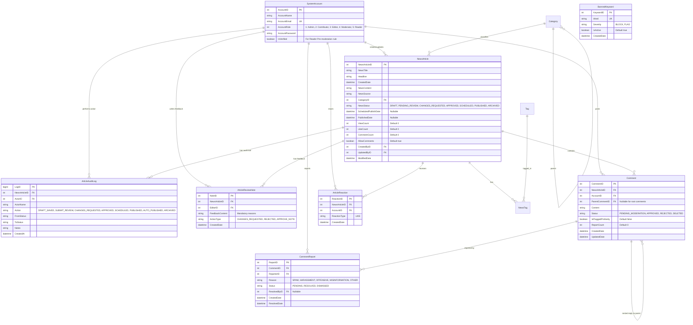
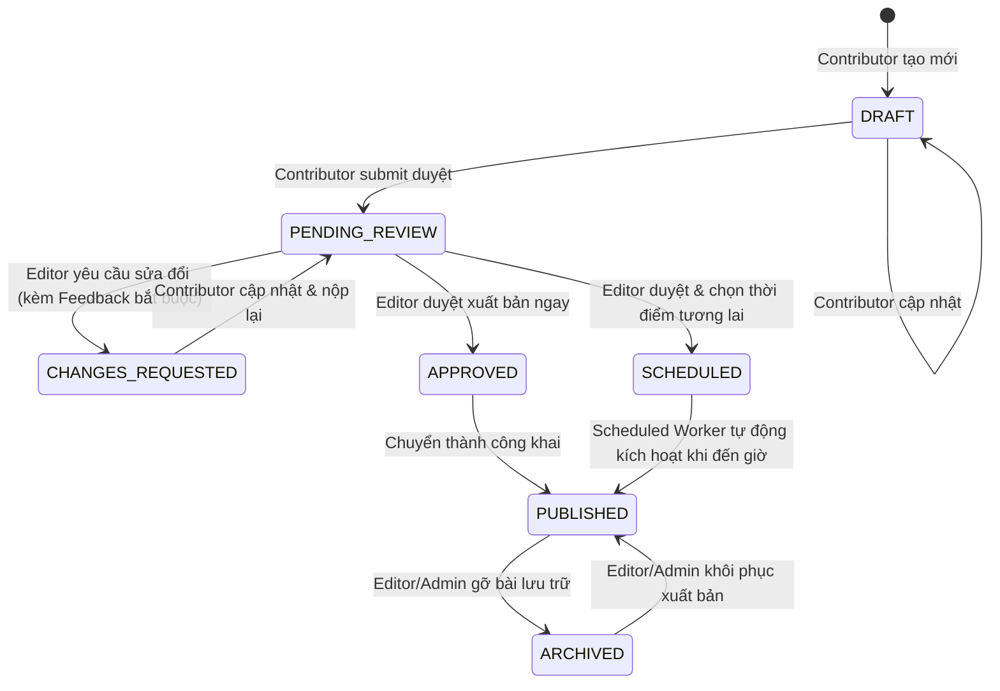
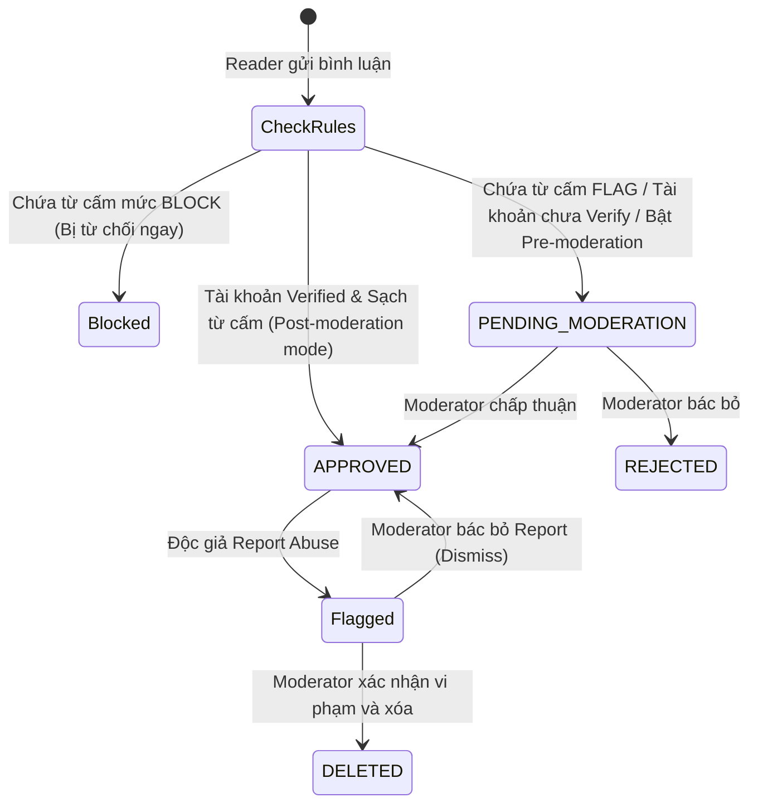
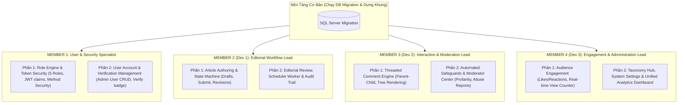

# KẾ HOẠCH TỔNG THỂ & KIẾN TRÚC HỆ THỐNG: NÂNG CẤP DỰ ÁN THEO REPORT 2
**Dự án**: FPT University News Management System (FUNewsManagementSystem)  
**Tài liệu tham chiếu**: `NMS_Report.pdf` (Report 1) & `Report_2.pdf` (SRS Enhancement)  
**Ngày lập kế hoạch**: 26/10/2026  
**Mục tiêu**: Nâng cấp toàn diện kiến trúc Backend (Spring Boot 3) và Frontend (React Vite) từ hệ thống quản lý tin tức cơ bản lên hệ thống xuất bản chuyên nghiệp với Quy trình Tòa soạn (Editorial Workflow) và Tương tác Độc giả Đa chiều (Audience Engagement & Moderation).

---

## 1. TỔNG QUAN & PHÂN TÍCH SO SÁNH (REPORT 1 VS REPORT 2)

### 1.1. Hiện trạng hệ thống (Dựa trên Report 1 & Source Code hiện tại)
Hệ thống hiện tại đã hoàn thiện khung cơ bản theo tiêu chuẩn Assignment 01:
- **Xác thực & Người dùng**: Quản lý tài khoản `SystemAccount` với 2 vai trò nhị phân: `ADMIN (1)` và `STAFF (2)`. Xác thực thông qua JWT token và BCrypt.
- **Quản lý danh mục & thẻ**: CRUD `Category` (hỗ trợ quan hệ cha - con), CRUD `Tag`, liên kết n-n giữa bài viết và thẻ qua bảng `NewsTag`.
- **Quản lý bài viết**: CRUD `NewsArticle` đơn giản với trạng thái `NewsStatus` chỉ có 2 giá trị nhị phân (`0: Inactive`, `1: Active`). Tác giả tạo bài viết là bài có thể hiển thị trực tiếp.
- **Tiện ích phụ trợ**: Bảng `Notification` thông báo cơ bản, `SystemSetting` lưu cấu hình key-value, `Dashboard` thống kê số lượng bản ghi.

### 1.2. Yêu cầu mở rộng theo Report 2 (SRS Enhancement)
Report 2 đưa ra hai đột phá lớn về nghiệp vụ:
1. **Module 1: Editorial Workflow & Approval Management (Quy trình biên tập & Duyệt xuất bản)**:
   - Chuyển đổi trạng thái bài viết từ nhị phân (0/1) sang **Máy trạng thái 6 nấc** nghiêm ngặt: `DRAFT` $\rightarrow$ `PENDING_REVIEW` $\rightarrow$ `CHANGES_REQUESTED` $\rightarrow$ `APPROVED` $\rightarrow$ `SCHEDULED` $\rightarrow$ `PUBLISHED` $\rightarrow$ `ARCHIVED`.
   - Phân định rõ vai trò tòa soạn:
     - **Contributor (Giảng viên / Nhân viên)**: Soạn thảo bài, sửa đổi theo yêu cầu, nộp duyệt; không có quyền tự xuất bản.
     - **Editor (Trưởng ban / Biên tập viên cấp cao)**: Hàng đợi duyệt bài (Review Queue), phản hồi yêu cầu sửa đổi bắt buộc (Mandatory notes), duyệt xuất bản hoặc lên lịch hẹn giờ xuất bản tương lai.
     - **Administrator**: Toàn quyền can thiệp, gỡ bài, cấu hình hệ thống.
   - Lên lịch xuất bản tự động (**Automated Content Scheduling**): Worker chạy nền tự động chuyển trạng thái bài từ `SCHEDULED` sang `PUBLISHED` đúng mốc thời gian chỉ định.
   - Nhật ký kiểm toán (**Audit Trail & Logging**): Bảng ghi bất biến (Immutable log) lưu vết lịch sử mọi lần đổi trạng thái (ai đổi, từ trạng thái nào sang trạng thái nào, ghi chú kèm theo, thời điểm).
2. **Module 2: Comment & Audience Engagement Management (Bình luận & Đo lường tương tác)**:
   - Vai trò mới: **Reader (Độc giả / Sinh viên / Khách)** và **Moderator (Kiểm duyệt viên)**.
   - Bình luận lồng nhau đa cấp (**Nested Replies / Threading**).
   - Đường ống kiểm duyệt bình luận (**Moderation Pipeline**): Hỗ trợ cơ chế Pre-moderation (bình luận từ tài khoản chưa xác thực phải chờ duyệt) và Post-moderation (hiển thị ngay, duyệt sau nếu có báo cáo). Trạng thái bình luận: `PENDING_MODERATION`, `APPROVED`, `REJECTED`, `DELETED`.
   - Hàng rào phòng vệ tự động (**Automated Safeguards**): Tự động lọc từ ngữ thô tục/spam (Profanity & Spam Keyword Filter); Chức năng bạn đọc Báo cáo vi phạm (**Report Abuse**).
   - Đo lường tương tác (**Engagement Metrics**): Thả tim/Like bài viết (`ArticleReaction`), bộ đếm lượt xem bài viết thời gian thực (`ViewCount`), thống kê lượng bình luận.

---

## 2. THIẾT KẾ CƠ SỞ DỮ LIỆU TỔNG THỂ (DATABASE SCHEMA & ERD)

### 2.1. Sơ đồ thực thể ERD nâng cấp



### 2.2. Kịch bản DDL cập nhật Cơ sở dữ liệu (SQL Server)
Kịch bản này cung cấp sẵn các lệnh `ALTER TABLE` và `CREATE TABLE` độc lập. Chạy kịch bản này một lần duy nhất vào cơ sở dữ liệu `FUNewsManagementSystem` để tất cả các lập trình viên cùng làm việc mà không làm xáo trộn dữ liệu cũ:

```sql
-- 1. Cập nhật bảng SystemAccount: Thêm cờ IsVerified và nới lỏng Check Role (1..5)
ALTER TABLE SystemAccount ADD IsVerified BIT NOT NULL CONSTRAINT DF_SystemAccount_IsVerified DEFAULT 0;

-- Xóa ràng buộc cũ (nếu có) và tạo mới cho 5 roles
IF EXISTS (SELECT * FROM sys.check_constraints WHERE name = 'CK_SystemAccount_Role')
    ALTER TABLE SystemAccount DROP CONSTRAINT CK_SystemAccount_Role;

ALTER TABLE SystemAccount ADD CONSTRAINT CK_SystemAccount_Role 
    CHECK (AccountRole IN (1, 2, 3, 4, 5)); -- 1: ADMIN, 2: CONTRIBUTOR, 3: EDITOR, 4: MODERATOR, 5: READER

-- 2. Cập nhật bảng NewsArticle: Chuyển đổi trạng thái và thêm các trường tương tác, lên lịch
-- Thay đổi NewsStatus từ int sang nvarchar(30)
IF EXISTS (SELECT * FROM sys.check_constraints WHERE name = 'CK_NewsArticle_Status')
    ALTER TABLE NewsArticle DROP CONSTRAINT CK_NewsArticle_Status;

ALTER TABLE NewsArticle ALTER COLUMN NewsStatus NVARCHAR(30) NOT NULL;

-- Cập nhật dữ liệu cũ tương thích
UPDATE NewsArticle SET NewsStatus = 'PUBLISHED' WHERE NewsStatus = '1';
UPDATE NewsArticle SET NewsStatus = 'ARCHIVED' WHERE NewsStatus = '0';

ALTER TABLE NewsArticle ADD CONSTRAINT CK_NewsArticle_Status CHECK (
    NewsStatus IN ('DRAFT', 'PENDING_REVIEW', 'CHANGES_REQUESTED', 'APPROVED', 'SCHEDULED', 'PUBLISHED', 'ARCHIVED')
);

ALTER TABLE NewsArticle ADD ScheduledPublishDate DATETIME2 NULL;
ALTER TABLE NewsArticle ADD PublishedDate DATETIME2 NULL;
ALTER TABLE NewsArticle ADD ViewCount INT NOT NULL CONSTRAINT DF_NewsArticle_ViewCount DEFAULT 0;
ALTER TABLE NewsArticle ADD LikeCount INT NOT NULL CONSTRAINT DF_NewsArticle_LikeCount DEFAULT 0;
ALTER TABLE NewsArticle ADD CommentCount INT NOT NULL CONSTRAINT DF_NewsArticle_CommentCount DEFAULT 0;
ALTER TABLE NewsArticle ADD AllowComments BIT NOT NULL CONSTRAINT DF_NewsArticle_AllowComments DEFAULT 1;

-- 3. Tạo bảng ArticleReviewNote (Ghi chú phản hồi duyệt bài)
CREATE TABLE ArticleReviewNote (
    NoteID INT IDENTITY(1,1) PRIMARY KEY,
    NewsArticleID INT NOT NULL CONSTRAINT FK_ReviewNote_Article REFERENCES NewsArticle(NewsArticleID) ON DELETE CASCADE,
    EditorID INT NOT NULL CONSTRAINT FK_ReviewNote_Editor REFERENCES SystemAccount(AccountID),
    FeedbackContent NVARCHAR(MAX) NOT NULL,
    ActionType NVARCHAR(50) NOT NULL, -- CHANGES_REQUESTED, REJECTED, APPROVE_NOTE
    CreatedDate DATETIME2 NOT NULL DEFAULT SYSUTCDATETIME()
);

-- 4. Tạo bảng ArticleAuditLog (Nhật ký kiểm toán trạng thái bài viết)
CREATE TABLE ArticleAuditLog (
    LogID BIGINT IDENTITY(1,1) PRIMARY KEY,
    NewsArticleID INT NOT NULL CONSTRAINT FK_AuditLog_Article REFERENCES NewsArticle(NewsArticleID) ON DELETE CASCADE,
    ActorID INT NOT NULL CONSTRAINT FK_AuditLog_Actor REFERENCES SystemAccount(AccountID),
    ActorName NVARCHAR(100) NOT NULL,
    Action NVARCHAR(50) NOT NULL,
    FromStatus NVARCHAR(30) NULL,
    ToStatus NVARCHAR(30) NOT NULL,
    Notes NVARCHAR(MAX) NULL,
    CreatedAt DATETIME2 NOT NULL DEFAULT SYSUTCDATETIME()
);
CREATE INDEX IX_ArticleAuditLog_Article ON ArticleAuditLog(NewsArticleID, CreatedAt DESC);

-- 5. Tạo bảng Comment (Bình luận lồng nhau đa cấp)
CREATE TABLE Comment (
    CommentID INT IDENTITY(1,1) PRIMARY KEY,
    NewsArticleID INT NOT NULL CONSTRAINT FK_Comment_Article REFERENCES NewsArticle(NewsArticleID) ON DELETE CASCADE,
    AccountID INT NOT NULL CONSTRAINT FK_Comment_Account REFERENCES SystemAccount(AccountID),
    ParentCommentID INT NULL CONSTRAINT FK_Comment_Parent REFERENCES Comment(CommentID),
    Content NVARCHAR(MAX) NOT NULL,
    Status NVARCHAR(30) NOT NULL DEFAULT 'APPROVED',
    IsFlaggedProfanity BIT NOT NULL DEFAULT 0,
    ReportCount INT NOT NULL DEFAULT 0,
    CreatedDate DATETIME2 NOT NULL DEFAULT SYSUTCDATETIME(),
    UpdatedDate DATETIME2 NULL,
    CONSTRAINT CK_Comment_Status CHECK (Status IN ('PENDING_MODERATION', 'APPROVED', 'REJECTED', 'DELETED'))
);
CREATE INDEX IX_Comment_Article_Status ON Comment(NewsArticleID, Status, CreatedDate ASC);

-- 6. Tạo bảng CommentReport (Báo cáo bình luận vi phạm)
CREATE TABLE CommentReport (
    ReportID INT IDENTITY(1,1) PRIMARY KEY,
    CommentID INT NOT NULL CONSTRAINT FK_CommentReport_Comment REFERENCES Comment(CommentID) ON DELETE CASCADE,
    ReporterID INT NOT NULL CONSTRAINT FK_CommentReport_Reporter REFERENCES SystemAccount(AccountID),
    Reason NVARCHAR(500) NOT NULL,
    Status NVARCHAR(30) NOT NULL DEFAULT 'PENDING',
    ResolvedByID INT NULL CONSTRAINT FK_CommentReport_Resolver REFERENCES SystemAccount(AccountID),
    CreatedDate DATETIME2 NOT NULL DEFAULT SYSUTCDATETIME(),
    ResolvedDate DATETIME2 NULL,
    CONSTRAINT CK_CommentReport_Status CHECK (Status IN ('PENDING', 'RESOLVED', 'DISMISSED'))
);

-- 7. Tạo bảng ArticleReaction (Lượt thích bài viết)
CREATE TABLE ArticleReaction (
    ReactionID INT IDENTITY(1,1) PRIMARY KEY,
    NewsArticleID INT NOT NULL CONSTRAINT FK_Reaction_Article REFERENCES NewsArticle(NewsArticleID) ON DELETE CASCADE,
    AccountID INT NOT NULL CONSTRAINT FK_Reaction_Account REFERENCES SystemAccount(AccountID),
    ReactionType NVARCHAR(20) NOT NULL DEFAULT 'LIKE',
    CreatedDate DATETIME2 NOT NULL DEFAULT SYSUTCDATETIME(),
    CONSTRAINT UQ_Article_Account_Reaction UNIQUE (NewsArticleID, AccountID, ReactionType)
);

-- 8. Tạo bảng BannedKeyword (Từ khóa cấm/nhạy cảm)
CREATE TABLE BannedKeyword (
    KeywordID INT IDENTITY(1,1) PRIMARY KEY,
    Word NVARCHAR(100) NOT NULL CONSTRAINT UQ_BannedKeyword_Word UNIQUE,
    Severity NVARCHAR(20) NOT NULL DEFAULT 'BLOCK', -- BLOCK (chặn ngay), FLAG (cho phép gửi nhưng đánh dấu cảnh báo)
    IsActive BIT NOT NULL DEFAULT 1,
    CreatedDate DATETIME2 NOT NULL DEFAULT SYSUTCDATETIME()
);
```

---

## 3. MÁY TRẠNG THÁI & MA TRẬN PHÂN QUYỀN (STATE MACHINES & RBAC)

### 3.1. Máy trạng thái Bài viết (Article State Machine)



### 3.2. Đường ống duyệt Bình luận (Comment Moderation Pipeline)



### 3.3. Ma trận phân quyền Role-Based Access Control (RBAC)

| Chức năng / Hành động | ADMIN (1) | CONTRIBUTOR (2) | EDITOR (3) | MODERATOR (4) | READER (5) | PUBLIC (Khách) |
| :--- | :---: | :---: | :---: | :---: | :---: | :---: |
| Đăng nhập / Đăng ký / Đổi mật khẩu | Có | Có | Có | Có | Có | Đăng ký/Login |
| Quản lý tài khoản (CRUD, Phân Role, Verify) | **Toàn quyền** | Không | Không | Không | Xem profile cá nhân | Không |
| Tạo bản nháp bài viết (Draft) | Có | **Chính** | Có | Không | Không | Không |
| Sửa bài viết của chính mình (Draft / Re-submit) | Có | **Chính** | Có | Không | Không | Không |
| Nộp duyệt bài viết (`SUBMIT_FOR_REVIEW`) | Có | **Chính** | Có | Không | Không | Không |
| Xem Review Queue & Đọc bài chờ duyệt | Có | Không | **Chính** | Không | Không | Không |
| Yêu cầu sửa đổi kèm phản hồi (`CHANGES_REQUESTED`)| Có | Không | **Chính** | Không | Không | Không |
| Duyệt xuất bản ngay hoặc hẹn giờ (`SCHEDULED`) | Có | Không | **Chính** | Không | Không | Không |
| Gỡ bài / Lưu trữ (`ARCHIVED`) | **Toàn quyền**| Không | Có | Không | Không | Không |
| Xem Audit Trail lịch sử duyệt bài | Có | Chỉ bài của mình| Có | Không | Không | Không |
| Đọc bài viết đã xuất bản (`PUBLISHED`) | Có | Có | Có | Có | Có | **Có** |
| Thả Like / Reaction bài viết | Có | Có | Có | Có | **Có** | Phải đăng nhập |
| Gửi bình luận / Trả lời lồng nhau | Có | Có | Có | Có | **Có** | Phải đăng nhập |
| Báo cáo bình luận vi phạm (Report Abuse) | Có | Có | Có | Có | **Có** | Phải đăng nhập |
| Duyệt bình luận (Approve / Reject / Delete) | Có | Không | Không | **Chính** | Không | Không |
| Quản lý Từ khóa cấm (Banned Keywords) | Có | Không | Không | **Chính** | Không | Không |
| Quản lý Danh mục & Thẻ bài viết | **Toàn quyền** | Chỉ đọc | Chỉ đọc | Không | Chỉ đọc | Chỉ đọc |
| Cấu hình hệ thống (Comment switch, Mode) | **Toàn quyền** | Không | Không | Không | Không | Không |
| Xem Thống kê Dashboard Tòa soạn & Tương tác | **Toàn diện** | Dashboard cá nhân| Dashboard tòa soạn| Dashboard kiểm duyệt| Không | Không |

---

## 4. CHIẾN LƯỢC PHÂN CHIA CÔNG VIỆC & PHÒNG CHỐNG XUNG ĐỘT (ANTI-CONFLICT ARCHITECTURE)

Nhằm đáp ứng yêu cầu: **"Chia việc làm 4 người (1 người User/Security + 3 người còn lại, mỗi người tối thiểu 2 phần), hạn chế ảnh hưởng nhau nhất có thể, tránh chờ đợi nhau code hay code đè config"**, kiến trúc phân rã công việc được thiết kế theo nguyên tắc **Decoupled Boundary**:

### 4.1. Bảng phân công 4 vị trí độc lập



| Thành viên | Trách nhiệm chính | Phần 1 đảm nhiệm | Phần 2 đảm nhiệm | Phạm vi file (Zero Conflict) |
| :--- | :--- | :--- | :--- | :--- |
| **Member 1** | **User, Auth & Security** | Cập nhật 5 Roles, JWT Payload, Spring Security & Method Security | Quản lý Tài khoản (CRUD), Xác minh User (`isVerified`), Profile cá nhân | `security/**`, `controller/UserController`, `controller/AuthController`, `pages/users/**`, `pages/auth/**` |
| **Member 2** | **Dev 1: Editorial Workflow** | Quản lý vòng đời bài viết (Draft $\rightarrow$ Submit), Form soạn thảo của Contributor | Review Queue của Editor, Yêu cầu sửa đổi, Duyệt & Hẹn giờ, Scheduled Worker, Audit Trail | `entity/ArticleReviewNote`, `entity/ArticleAuditLog`, `controller/EditorialController`, `scheduler/**`, `pages/news/editorial/**` |
| **Member 3** | **Dev 2: Comments & Moderation** | Động cơ bình luận phân cấp lồng nhau (Tree), Đăng comment, Kiểm tra trạng thái duyệt | Bộ lọc từ khóa cấm (Profanity Filter), Báo cáo vi phạm (Abuse Reports), Bảng kiểm duyệt của Moderator | `entity/Comment`, `entity/CommentReport`, `entity/BannedKeyword`, `controller/CommentController`, `controller/ModerationController`, `pages/moderation/**` |
| **Member 4** | **Dev 3: Engagement & Taxonomy** | Đo lường tương tác: Thả Tim (Reactions), Đếm lượt xem bài thời gian thực (Views Counter), Public Portal API | Nâng cấp Danh mục (Category) & Thẻ (Tag), Cấu hình hệ thống (Settings), Dashboard thống kê tòa soạn & tương tác | `entity/ArticleReaction`, `controller/EngagementController`, `controller/CategoryController`, `controller/DashboardController`, `pages/dashboard/**` |

### 4.2. Chiến lược "Zero-Conflict" trong cấu hình và chia sẻ mã nguồn

#### A. Phòng chống xung đột Backend (`SecurityConfig.java` & `application.properties`)
- **Vấn đề thường gặp**: Mọi người cùng vào sửa danh sách quyền `.requestMatchers(...)` trong `SecurityConfig.java` dẫn đến Merge Conflict liên tục.
- **Giải pháp dứt điểm**:
  1. Member 1 hoàn thiện `SecurityConfig.java` ngày đầu tiên với cơ chế mở:
     - Cho phép Public các đường dẫn: `/swagger-ui/**`, `/v3/api-docs/**`, `/api/v1/auth/**`, `/api/v1/portal/**`.
     - Tất cả các API nghiệp vụ nội bộ còn lại chỉ cần `authenticated()`.
  2. Bật cờ `@EnableMethodSecurity(prePostEnabled = true)`.
  3. **Mỗi lập trình viên tự bảo vệ API trong Controller của chính mình** bằng Annotation của Spring Security. Ví dụ:
     - Member 2: `@PreAuthorize("hasAnyRole('EDITOR', 'ADMIN')")` đặt ngay trên `EditorialController`.
     - Member 3: `@PreAuthorize("hasAnyRole('MODERATOR', 'ADMIN')")` đặt ngay trên `ModerationController`.
     - Member 4: `@PreAuthorize("hasRole('ADMIN')")` đặt ngay trên `SystemSettingController`.
  $\rightarrow$ **Không bao giờ phải mở lại file `SecurityConfig.java` để chỉnh sửa!**

#### B. Phòng chống xung đột Entity (`NewsArticle.java`)
- **Vấn đề**: `NewsArticle` là thực thể trung tâm được nhiều module tương tác (Dev 1 sửa status, Dev 2 cần gắn comment, Dev 3 cần đếm view/like).
- **Giải pháp**:
  - DDL SQL Server chạy 1 lần bổ sung đầy đủ cột ngay từ đầu.
  - Member 2 là chủ sở hữu (Owner) của `NewsArticle.java`.
  - Member 3 (`Comment`) và Member 4 (`ArticleReaction`) **không cần sửa `NewsArticle.java`**:
    - Trong `Comment.java`, chỉ cần `@Column(name = "NewsArticleID") private Integer newsArticleId;` hoặc liên kết Read-only `@ManyToOne(fetch = FetchType.LAZY)`.
    - Trong `ArticleReaction.java`, chỉ cần `@Column(name = "NewsArticleID") private Integer newsArticleId;`.
  $\rightarrow$ Hoàn toàn độc lập, không ai phải đợi ai!

#### C. Phòng chống xung đột Frontend (`App.jsx` & Router)
- **Vấn đề**: Nhiều nhánh Git cùng chèn `<Route path="..." element={...} />` vào giữa file `App.jsx`.
- **Giải pháp**:
  - Mỗi thành viên tự tạo thư mục trang riêng của mình trong `src/pages/`:
    - Member 1: `src/pages/users/`, `src/pages/auth/`
    - Member 2: `src/pages/editorial/`
    - Member 3: `src/pages/moderation/`, `src/components/comment/`
    - Member 4: `src/pages/portal/`, `src/pages/settings/`, `src/pages/dashboard/`
  - Mỗi thành viên tạo file API Axios riêng biệt trong `src/api/` (`auth.js`, `editorial.js`, `comment.js`, `engagement.js`), tuyệt đối không viết chung vào một file `api.js`.
  - Khung Router trong `App.jsx` được khai báo khung trước từ đầu (xem mẫu trong file chi tiết), các dev chỉ việc import component của mình vào đúng vị trí giữ chỗ.

---

## 5. BỘ TÀI LIỆU CHI TIẾT ĐÍNH KÈM

Để nắm rõ toàn bộ logic, mã nguồn, đặc tả từng hàm và lớp cho từng cá nhân, vui lòng tham khảo 4 file tài liệu chuyên biệt tương ứng:

1. **[01_USER_AUTH_SECURITY.md](file:///c:/Fall%202026/SBA301/SBA301_ASS/plan_report2/01_USER_AUTH_SECURITY.md)**: Đặc tả chi tiết hạ tầng 5 Roles, JWT Payload, Phân quyền Method Security, Quản lý tài khoản và nghiệp vụ Xác minh User phục vụ Pre-moderation.
2. **[02_DEV1_EDITORIAL_WORKFLOW.md](file:///c:/Fall%202026/SBA301/SBA301_ASS/plan_report2/02_DEV1_EDITORIAL_WORKFLOW.md)**: Đặc tả chi tiết Máy trạng thái bài viết, Giao diện Contributor nộp bài, Review Queue của Editor, Lên lịch tự động (Scheduled Worker) và Nhật ký Audit Trail bất biến.
3. **[03_DEV2_COMMENT_VA_MODERATION.md](file:///c:/Fall%202026/SBA301/SBA301_ASS/plan_report2/03_DEV2_COMMENT_VA_MODERATION.md)**: Đặc tả chi tiết Cây bình luận đa cấp (Nested Tree), Thuật toán lọc từ cấm tự động (Profanity Filter), Cơ chế Báo cáo vi phạm (Abuse Reporting) và Bảng duyệt của Kiểm duyệt viên.
4. **[04_DEV3_ENGAGEMENT_TAXONOMY_DASHBOARD.md](file:///c:/Fall%202026/SBA301/SBA301_ASS/plan_report2/04_DEV3_ENGAGEMENT_TAXONOMY_DASHBOARD.md)**: Đặc tả chi tiết Đo lường tương tác (Thả Like, Bộ đếm View thời gian thực), Nâng cấp Danh mục/Tag, Cấu hình hệ thống và Dashboard thống kê trực quan.
