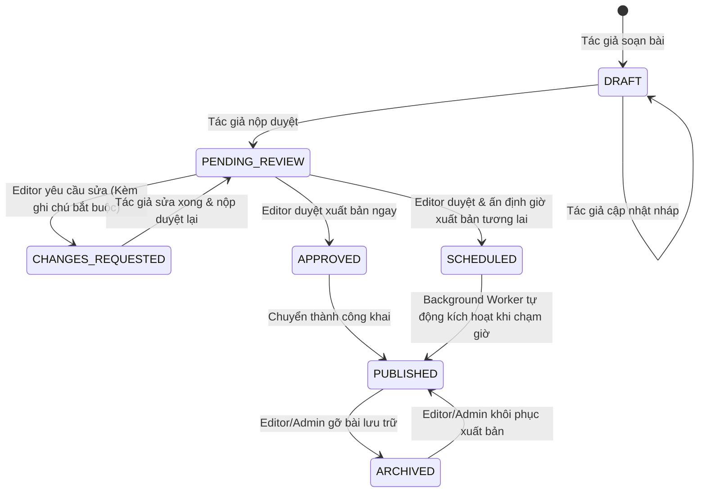

# KẾ HOẠCH CHI TIẾT: QUY TRÌNH BIÊN TẬP, PHÊ DUYỆT & LÊN LỊCH XUẤT BẢN (EDITORIAL WORKFLOW)
**Người đảm nhiệm**: Dev 1 - Trưởng phụ trách Quy trình Xuất bản & Tòa soạn  
**Phạm vi phụ trách**: 
1. **Phần 1**: Quản lý Vòng đời Bài viết & Không gian Tác giả (Article Lifecycle State Machine, Contributor Draft & Submission Flow).
2. **Phần 2**: Hàng đợi Phê duyệt, Cơ chế Phản hồi Bắt buộc, Lên lịch Tự động & Nhật ký Kiểm toán (Editorial Review Queue, Mandatory Feedback, Automated Scheduler Worker & Immutable Audit Trail).  
**Tài liệu tham chiếu**: Report 2 (Mục 3. Module 1: Editorial Workflow & Approval Management: FR-ED-001, FR-ED-002, FR-ED-003, FR-ED-004, NFR-ED-001..005, AC-ED-001..004).

---

## 1. MÁY TRẠNG THÁI VÒNG ĐỜI BÀI VIẾT (STATE MACHINE SPECIFICATION)

Hệ thống bắt buộc thực thi máy trạng thái 6 nấc nghiêm ngặt theo yêu cầu `FR-ED-001`:



### Bảng Ma trận Chuyển trạng thái Hợp lệ (Valid State Transitions)
| Từ trạng thái (From) | Sang trạng thái (To) | Hành động kích hoạt | Vai trò cho phép | Ghi chú điều kiện |
| :--- | :--- | :--- | :--- | :--- |
| `[Mới]` | `DRAFT` | Tạo bài viết mới | CONTRIBUTOR, ADMIN | Chỉ tác giả nhìn thấy bài |
| `DRAFT` | `PENDING_REVIEW` | Nộp duyệt (`SUBMIT`) | CONTRIBUTOR (Tác giả) | Khóa quyền chỉnh sửa của tác giả (`AC-ED-001`) |
| `CHANGES_REQUESTED` | `PENDING_REVIEW` | Nộp lại sau sửa đổi | CONTRIBUTOR (Tác giả) | Khóa quyền chỉnh sửa lại |
| `PENDING_REVIEW` | `CHANGES_REQUESTED` | Yêu cầu sửa đổi | EDITOR, ADMIN | **Bắt buộc** kèm ghi chú phản hồi (`AC-ED-002`) |
| `PENDING_REVIEW` | `APPROVED` | Duyệt xuất bản ngay | EDITOR, ADMIN | Đặt `PublishedDate = now()` |
| `PENDING_REVIEW` | `SCHEDULED` | Hẹn giờ xuất bản | EDITOR, ADMIN | Bắt buộc `ScheduledPublishDate > now()` (`AC-ED-003`) |
| `SCHEDULED` | `PUBLISHED` | Tự động xuất bản | Background Scheduler | Tự động chuyển khi `ScheduledPublishDate <= now()` |
| `PUBLISHED` | `ARCHIVED` | Gỡ bài / Lưu trữ | EDITOR, ADMIN | Không hiển thị công khai, giữ audit log |
| `ARCHIVED` | `PUBLISHED` | Khôi phục xuất bản | EDITOR, ADMIN | Mở lại bài đã lưu trữ |

---

## 2. THIẾT KẾ CƠ SỞ DỮ LIỆU & CÁC ENTITY

Dev 1 chịu trách nhiệm quản lý và cập nhật 3 thực thể sau:

### 2.1. Entity `NewsArticle.java` (Cập nhật)
```java
package com.mvc.nms_be.entity;

import jakarta.persistence.*;
import lombok.Getter;
import lombok.NoArgsConstructor;
import lombok.Setter;
import java.time.LocalDateTime;
import java.util.ArrayList;
import java.util.List;

@Entity
@Table(name = "NewsArticle", indexes = {
        @Index(name = "IX_NewsArticle_Status_Date", columnList = "NewsStatus, PublishedDate"),
        @Index(name = "IX_NewsArticle_Scheduled", columnList = "NewsStatus, ScheduledPublishDate"),
        @Index(name = "IX_NewsArticle_Creator", columnList = "CreatedByID")
})
@Getter
@Setter
@NoArgsConstructor
public class NewsArticle {

    public static final String STATUS_DRAFT = "DRAFT";
    public static final String STATUS_PENDING_REVIEW = "PENDING_REVIEW";
    public static final String STATUS_CHANGES_REQUESTED = "CHANGES_REQUESTED";
    public static final String STATUS_APPROVED = "APPROVED";
    public static final String STATUS_SCHEDULED = "SCHEDULED";
    public static final String STATUS_PUBLISHED = "PUBLISHED";
    public static final String STATUS_ARCHIVED = "ARCHIVED";

    @Id
    @GeneratedValue(strategy = GenerationType.IDENTITY)
    @Column(name = "NewsArticleID")
    private Integer newsArticleId;

    @Column(name = "NewsTitle", nullable = false, length = 250, columnDefinition = "nvarchar(250)")
    private String newsTitle;

    @Column(name = "Headline", length = 500, columnDefinition = "nvarchar(500)")
    private String headline;

    @Column(name = "CreatedDate", nullable = false, updatable = false)
    private LocalDateTime createdDate = LocalDateTime.now();

    @Column(name = "NewsContent", nullable = false, columnDefinition = "nvarchar(max)")
    private String newsContent;

    @Column(name = "NewsSource", length = 250, columnDefinition = "nvarchar(250)")
    private String newsSource;

    @ManyToOne(fetch = FetchType.LAZY, optional = false)
    @JoinColumn(name = "CategoryID", nullable = false)
    private Category category;

    @Column(name = "NewsStatus", nullable = false, length = 30)
    private String newsStatus = STATUS_DRAFT;

    @Column(name = "ScheduledPublishDate")
    private LocalDateTime scheduledPublishDate;

    @Column(name = "PublishedDate")
    private LocalDateTime publishedDate;

    @Column(name = "ViewCount", nullable = false)
    private Integer viewCount = 0;

    @Column(name = "LikeCount", nullable = false)
    private Integer likeCount = 0;

    @Column(name = "CommentCount", nullable = false)
    private Integer commentCount = 0;

    @Column(name = "AllowComments", nullable = false)
    private Boolean allowComments = true;

    @ManyToOne(fetch = FetchType.LAZY, optional = false)
    @JoinColumn(name = "CreatedByID", nullable = false)
    private SystemAccount createdBy;

    @ManyToOne(fetch = FetchType.LAZY)
    @JoinColumn(name = "UpdatedByID")
    private SystemAccount updatedBy;

    @Column(name = "ModifiedDate")
    private LocalDateTime modifiedDate;

    @OneToMany(mappedBy = "newsArticle", cascade = CascadeType.ALL, orphanRemoval = true)
    private List<NewsTag> newsTags = new ArrayList<>();
}
```

### 2.2. Entity `ArticleReviewNote.java` (Thực thể mới - Phục vụ FR-ED-002)
Lưu trữ các nhận xét, lý do yêu cầu sửa đổi hoặc phản hồi từ Editor:
```java
package com.mvc.nms_be.entity;

import jakarta.persistence.*;
import lombok.Getter;
import lombok.NoArgsConstructor;
import lombok.Setter;
import java.time.LocalDateTime;

@Entity
@Table(name = "ArticleReviewNote")
@Getter
@Setter
@NoArgsConstructor
public class ArticleReviewNote {

    @Id
    @GeneratedValue(strategy = GenerationType.IDENTITY)
    @Column(name = "NoteID")
    private Integer noteId;

    @ManyToOne(fetch = FetchType.LAZY, optional = false)
    @JoinColumn(name = "NewsArticleID", nullable = false)
    private NewsArticle newsArticle;

    @ManyToOne(fetch = FetchType.LAZY, optional = false)
    @JoinColumn(name = "EditorID", nullable = false)
    private SystemAccount editor;

    @Column(name = "FeedbackContent", nullable = false, columnDefinition = "nvarchar(max)")
    private String feedbackContent;

    @Column(name = "ActionType", nullable = false, length = 50)
    private String actionType; // CHANGES_REQUESTED, REJECTED, APPROVE_NOTE

    @Column(name = "CreatedDate", nullable = false)
    private LocalDateTime createdDate = LocalDateTime.now();
}
```

### 2.3. Entity `ArticleAuditLog.java` (Thực thể mới - Phục vụ FR-ED-004 & AC-ED-004)
Lưu vết bất biến (Immutable Audit Log) lịch sử biến động trạng thái bài viết:
```java
package com.mvc.nms_be.entity;

import jakarta.persistence.*;
import lombok.Getter;
import lombok.NoArgsConstructor;
import lombok.Setter;
import java.time.LocalDateTime;

@Entity
@Table(name = "ArticleAuditLog")
@Getter
@Setter
@NoArgsConstructor
public class ArticleAuditLog {

    @Id
    @GeneratedValue(strategy = GenerationType.IDENTITY)
    @Column(name = "LogID")
    private Long logId;

    @Column(name = "NewsArticleID", nullable = false)
    private Integer newsArticleId;

    @Column(name = "ActorID", nullable = false)
    private Integer actorId;

    @Column(name = "ActorName", nullable = false, length = 100)
    private String actorName;

    @Column(name = "Action", nullable = false, length = 50)
    private String action; // CREATE_DRAFT, SUBMIT_REVIEW, REQUEST_CHANGES, APPROVE, SCHEDULE, PUBLISH, AUTO_PUBLISH, ARCHIVE

    @Column(name = "FromStatus", length = 30)
    private String fromStatus;

    @Column(name = "ToStatus", nullable = false, length = 30)
    private String toStatus;

    @Column(name = "Notes", columnDefinition = "nvarchar(max)")
    private String notes;

    @Column(name = "CreatedAt", nullable = false)
    private LocalDateTime createdAt = LocalDateTime.now();
}
```

---

## 3. LOGIC CHI TIẾT TỪNG PHẦN & ĐẶC TẢ CÁC HÀM (BUSINESS LOGIC)

### PHẦN 1: QUẢN LÝ TÁC GIẢ & SOẠN THẢO BÀI VIẾT (CONTRIBUTOR / AUTHOR WORKFLOW)

#### 1. Lớp Controller: `AuthorArticleController.java`
- **Đường dẫn**: `/api/v1/author/articles`
- **Bảo mật**: `@PreAuthorize("hasAnyRole('CONTRIBUTOR', 'ADMIN')")`
- **Các hàm chính**:
  1. `getMyArticles(String status, Pageable pageable)`: Lấy danh sách bài viết do chính tác giả đăng nhập tạo.
  2. `createDraft(NewsArticleRequestDto request)`: Tạo bài viết mới ở trạng thái `DRAFT`.
  3. `updateDraft(Integer id, NewsArticleRequestDto request)`: Cập nhật nội dung bài viết (Chỉ được phép khi bài ở trạng thái `DRAFT` hoặc `CHANGES_REQUESTED`).
  4. `submitForReview(Integer id)`: Nộp bài để chuyển sang trạng thái `PENDING_REVIEW`.
  5. `getFeedbackNotes(Integer id)`: Lấy danh sách nhận xét yêu cầu chỉnh sửa từ Editor gửi về.

#### 2. Chi tiết Thuật toán & Logic Hàm trong `AuthorArticleServiceImpl.java`

##### A. Hàm `submitForReview(Integer articleId)`
- **Mục đích**: Tác giả nộp bản nháp hoặc nộp bài sau khi sửa theo yêu cầu lên ban biên tập.
- **Thuật toán chi tiết**:
  ```java
  @Transactional
  public NewsArticleResponseDto submitForReview(Integer articleId) {
      Integer currentUserId = SecurityUtils.getCurrentAccountId();
      NewsArticle article = newsArticleRepository.findById(articleId)
              .orElseThrow(() -> new ResourceNotFoundException("Không tìm thấy bài viết: " + articleId));

      // 1. Kiểm tra quyền sở hữu
      if (!article.getCreatedBy().getAccountId().equals(currentUserId) && !SecurityUtils.isAdmin()) {
          throw new ForbiddenException("Bạn không có quyền nộp duyệt bài viết của người khác");
      }

      // 2. Kiểm tra điều kiện trạng thái hiện tại (State Machine Guard)
      String currentStatus = article.getNewsStatus();
      if (!NewsArticle.STATUS_DRAFT.equals(currentStatus) && 
          !NewsArticle.STATUS_CHANGES_REQUESTED.equals(currentStatus)) {
          throw new IllegalStateException("Chỉ có thể nộp duyệt bài ở trạng thái DRAFT hoặc CHANGES_REQUESTED. Trạng thái hiện tại: " + currentStatus);
      }

      // 3. Chuyển trạng thái sang PENDING_REVIEW (Khóa quyền sửa của tác giả)
      article.setNewsStatus(NewsArticle.STATUS_PENDING_REVIEW);
      article.setModifiedDate(LocalDateTime.now());
      newsArticleRepository.save(article);

      // 4. Ghi nhận Nhật ký kiểm toán (Audit Trail)
      auditLogService.logAction(
          article.getNewsArticleId(),
          currentUserId,
          SecurityUtils.getCurrentUser().getAccountName(),
          "SUBMIT_REVIEW",
          currentStatus,
          NewsArticle.STATUS_PENDING_REVIEW,
          "Tác giả đã nộp bài chờ ban biên tập phê duyệt"
      );

      return newsArticleMapper.toDto(article);
  }
  ```

##### B. Hàm `updateDraft(Integer articleId, NewsArticleRequestDto request)`
- **Thuật toán**:
  1. Kiểm tra tồn tại và quyền sở hữu tác giả.
  2. Kiểm tra trạng thái: Nếu trạng thái là `PENDING_REVIEW`, `APPROVED`, `SCHEDULED` hoặc `PUBLISHED` $\rightarrow$ Ném `ForbiddenException("Bài viết đang trong quy trình xét duyệt hoặc đã xuất bản, không được phép chỉnh sửa trực tiếp")`.
  3. Cập nhật các trường: `newsTitle`, `headline`, `newsContent`, `newsSource`, `category`.
  4. Cập nhật danh sách tags (`newsTags`).
  5. Ghi log kiểm toán `UPDATE_DRAFT`.

---

### PHẦN 2: BAN BIÊN TẬP, PHÊ DUYỆT, HẸN GIỜ & KIỂM TOÁN (EDITORIAL REVIEW, SCHEDULER & AUDIT)

#### 1. Lớp Controller: `EditorialController.java`
- **Đường dẫn**: `/api/v1/editorial`
- **Bảo mật**: `@PreAuthorize("hasAnyRole('EDITOR', 'ADMIN')")`
- **Các hàm chính**:
  1. `getReviewQueue(Pageable pageable)`: Lấy danh sách bài viết đang chờ duyệt (`PENDING_REVIEW`).
  2. `requestChanges(Integer id, FeedbackRequestDto request)`: Từ chối tạm thời và yêu cầu tác giả sửa bài (Kèm feedback bắt buộc).
  3. `approveAndPublishNow(Integer id)`: Duyệt xuất bản công khai ngay lập tức.
  4. `approveAndSchedule(Integer id, SchedulePublicationRequestDto request)`: Duyệt và hẹn giờ xuất bản trong tương lai.
  5. `archiveArticle(Integer id)`: Gỡ bài lưu trữ.
  6. `getArticleAuditTrail(Integer id)`: Lấy lịch sử biến động trạng thái bài viết.

#### 2. Chi tiết Thuật toán & Logic Hàm trong `EditorialServiceImpl.java`

##### A. Hàm `requestChanges(Integer articleId, FeedbackRequestDto feedbackDto)` (Đáp ứng FR-ED-002, AC-ED-002)
- **Quy tắc**: Editor **bắt buộc** phải cung cấp lý do/nhận xét thì hệ thống mới cho phép trả bài về.
- **Thuật toán chi tiết**:
  ```java
  @Transactional
  public void requestChanges(Integer articleId, FeedbackRequestDto feedbackDto) {
      // 1. Kiểm tra tính bắt buộc của Feedback (NFR-ED-002)
      if (feedbackDto.feedbackContent() == null || feedbackDto.feedbackContent().trim().isEmpty()) {
          throw new IllegalArgumentException("Yêu cầu phản hồi bắt buộc phải có nội dung ghi chú giải thích lý do");
      }

      NewsArticle article = newsArticleRepository.findById(articleId)
              .orElseThrow(() -> new ResourceNotFoundException("Bài viết không tồn tại: " + articleId));

      // 2. Kiểm tra trạng thái: Phải đang là PENDING_REVIEW
      if (!NewsArticle.STATUS_PENDING_REVIEW.equals(article.getNewsStatus())) {
          throw new IllegalStateException("Chỉ có thể yêu cầu sửa đổi đối với bài viết đang chờ duyệt (PENDING_REVIEW)");
      }

      // 3. Chuyển trạng thái sang CHANGES_REQUESTED
      String oldStatus = article.getNewsStatus();
      article.setNewsStatus(NewsArticle.STATUS_CHANGES_REQUESTED);
      article.setModifiedDate(LocalDateTime.now());
      newsArticleRepository.save(article);

      // 4. Lưu nhận xét vào bảng ArticleReviewNote
      Integer editorId = SecurityUtils.getCurrentAccountId();
      ArticleReviewNote note = new ArticleReviewNote();
      note.setNewsArticle(article);
      note.setEditor(accountRepository.getReferenceById(editorId));
      note.setFeedbackContent(feedbackDto.feedbackContent());
      note.setActionType("CHANGES_REQUESTED");
      note.setCreatedDate(LocalDateTime.now());
      reviewNoteRepository.save(note);

      // 5. Ghi Audit Log
      auditLogService.logAction(
          articleId,
          editorId,
          SecurityUtils.getCurrentUser().getAccountName(),
          "REQUEST_CHANGES",
          oldStatus,
          NewsArticle.STATUS_CHANGES_REQUESTED,
          feedbackDto.feedbackContent()
      );
  }
  ```

##### B. Hàm `approveAndSchedule(Integer articleId, SchedulePublicationRequestDto request)` (Đáp ứng FR-ED-003, AC-ED-003)
- **Thuật toán chi tiết**:
  ```java
  @Transactional
  public void approveAndSchedule(Integer articleId, SchedulePublicationRequestDto request) {
      LocalDateTime scheduleTime = request.scheduledPublishDate();
      LocalDateTime now = LocalDateTime.now();

      if (scheduleTime == null || scheduleTime.isBefore(now.plusMinutes(1))) {
          throw new IllegalArgumentException("Thời gian hẹn giờ xuất bản phải ở tương lai ít nhất 1 phút");
      }

      NewsArticle article = newsArticleRepository.findById(articleId)
              .orElseThrow(() -> new ResourceNotFoundException("Bài viết không tồn tại"));

      if (!NewsArticle.STATUS_PENDING_REVIEW.equals(article.getNewsStatus())) {
          throw new IllegalStateException("Chỉ bài viết ở PENDING_REVIEW mới có thể được duyệt và lên lịch");
      }

      String oldStatus = article.getNewsStatus();
      article.setNewsStatus(NewsArticle.STATUS_SCHEDULED);
      article.setScheduledPublishDate(scheduleTime);
      article.setModifiedDate(now);
      newsArticleRepository.save(article);

      auditLogService.logAction(
          articleId,
          SecurityUtils.getCurrentAccountId(),
          SecurityUtils.getCurrentUser().getAccountName(),
          "SCHEDULE",
          oldStatus,
          NewsArticle.STATUS_SCHEDULED,
          "Đã lên lịch xuất bản tự động vào: " + scheduleTime.toString()
      );
  }
  ```

##### C. Hàm `approveAndPublishNow(Integer articleId)`
- **Thuật toán**: Chuyển trạng thái từ `PENDING_REVIEW` sang `PUBLISHED`, gán `publishedDate = LocalDateTime.now()`, ghi Audit Log hành động `PUBLISH`.

---

### PHẦN 3: WORKER LÊN LỊCH XUẤT BẢN TỰ ĐỘNG (AUTOMATED CONTENT SCHEDULING WORKER)

#### Lớp: `com.mvc.nms_be.scheduler.ArticlePublishingScheduler.java` (Đáp ứng FR-ED-003 & AC-ED-003)
- **Công nghệ**: Spring `@Scheduled` + Transaction độc lập.
- **Cơ chế**:
  - Chạy chu kỳ định kỳ mỗi 60 giây (hoặc cấu hình cron: `0 * * * * *`).
  - Quét trong cơ sở dữ liệu các bài viết có điều kiện: `newsStatus = 'SCHEDULED'` và `scheduledPublishDate <= now()`.
  - Tự động chuyển các bài này sang `PUBLISHED`, gán `publishedDate = now()`.
  - Tự động ghi nhận `ArticleAuditLog` với `ActorName = "SYSTEM_SCHEDULER"`, `Action = "AUTO_PUBLISH"`.

```java
package com.mvc.nms_be.scheduler;

import com.mvc.nms_be.entity.NewsArticle;
import com.mvc.nms_be.repository.NewsArticleRepository;
import com.mvc.nms_be.service.ArticleAuditLogService;
import lombok.RequiredArgsConstructor;
import lombok.extern.slf4j.Slf4j;
import org.springframework.scheduling.annotation.Scheduled;
import org.springframework.stereotype.Component;
import org.springframework.transaction.annotation.Transactional;

import java.time.LocalDateTime;
import java.util.List;

@Slf4j
@Component
@RequiredArgsConstructor
public class ArticlePublishingScheduler {

    private final NewsArticleRepository newsArticleRepository;
    private final ArticleAuditLogService auditLogService;

    // Chạy mỗi phút quét 1 lần
    @Scheduled(cron = "0 * * * * *")
    @Transactional
    public void publishScheduledArticles() {
        LocalDateTime now = LocalDateTime.now();
        List<NewsArticle> readyArticles = newsArticleRepository
                .findAllByNewsStatusAndScheduledPublishDateLessThanEqual(NewsArticle.STATUS_SCHEDULED, now);

        if (readyArticles.isEmpty()) {
            return;
        }

        log.info("Phát hiện {} bài viết đến thời điểm xuất bản tự động", readyArticles.size());

        for (NewsArticle article : readyArticles) {
            article.setNewsStatus(NewsArticle.STATUS_PUBLISHED);
            article.setPublishedDate(now);
            newsArticleRepository.save(article);

            auditLogService.logAction(
                article.getNewsArticleId(),
                0, // System Account ID
                "SYSTEM_SCHEDULER",
                "AUTO_PUBLISH",
                NewsArticle.STATUS_SCHEDULED,
                NewsArticle.STATUS_PUBLISHED,
                "Hệ thống tự động kích hoạt xuất bản bài viết theo lịch hẹn"
            );
            log.info("Đã xuất bản tự động bài viết ID: {}", article.getNewsArticleId());
        }
    }
}
```

---

## 4. GIAO DIỆN FRONTEND (REACT VITE) CHO DEV 1

Dev 1 làm việc độc lập trong thư mục `src/pages/editorial/` và `src/api/editorial.js`:

1. **Trang Quản lý Bài viết của Tác giả (`src/pages/editorial/AuthorArticles.jsx`)**:
   - Tab chuyển đổi: Tất cả, Bản nháp (Draft), Chờ duyệt (Pending Review), Yêu cầu sửa (Changes Requested), Đã xuất bản (Published).
   - Form soạn thảo bài viết: Tiêu đề, Tóm tắt (Headline), Nội dung Rich Text/Markdown, Chọn danh mục, Gắn tags.
   - 2 nút hành động chính:
     - Nút **"Lưu bản nháp"** (`POST /api/v1/author/articles`).
     - Nút **"Nộp phê duyệt"** (`POST /api/v1/author/articles/{id}/submit`).
   - Modal xem chi tiết phản hồi (Feedback) từ Ban biên tập gửi về khi bài có trạng thái `CHANGES_REQUESTED`.
2. **Hàng đợi Phê duyệt của Ban Biên tập (`src/pages/editorial/EditorialQueue.jsx`)**:
   - Danh sách bài viết chờ duyệt (`PENDING_REVIEW`).
   - Đảm bảo tiêu chí `NFR-ED-005` (Phê duyệt hoặc yêu cầu sửa đổi trong $\le$ 3 click):
     - Click 1: Mở bài xem xét.
     - Click 2: Bấm nút "Yêu cầu sửa" (Mở popup nhập lý do) hoặc "Duyệt xuất bản".
     - Click 3: Bấm xác nhận lưu $\rightarrow$ Hoàn tất!
3. **Modal Hẹn giờ Xuất bản (`src/pages/editorial/ScheduleModal.jsx`)**:
   - Cho phép Editor chọn ngày và giờ xuất bản tương lai (DatePicker + TimePicker).
4. **Component Xem Lịch sử Kiểm toán (`src/components/editorial/AuditTrailTimeline.jsx`)**:
   - Hiển thị dòng thời gian trực quan (Timeline UI) hiển thị từng bước: Ai nộp lúc nào, Ai yêu cầu sửa gì, Ai duyệt lúc nào.
